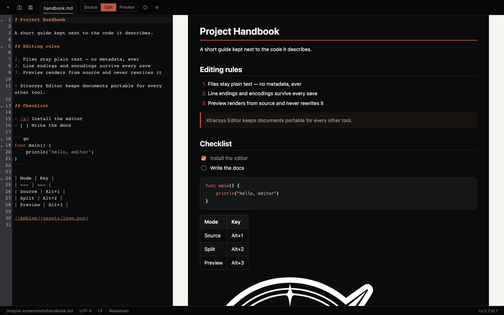
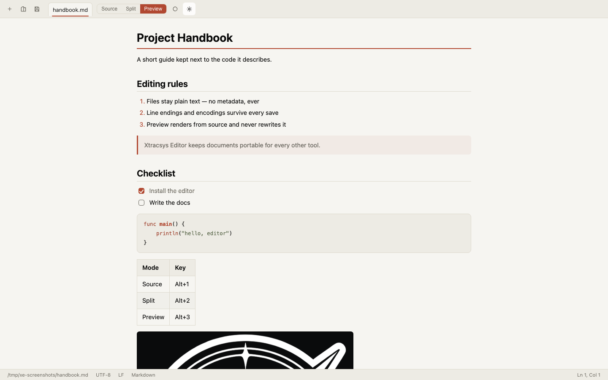
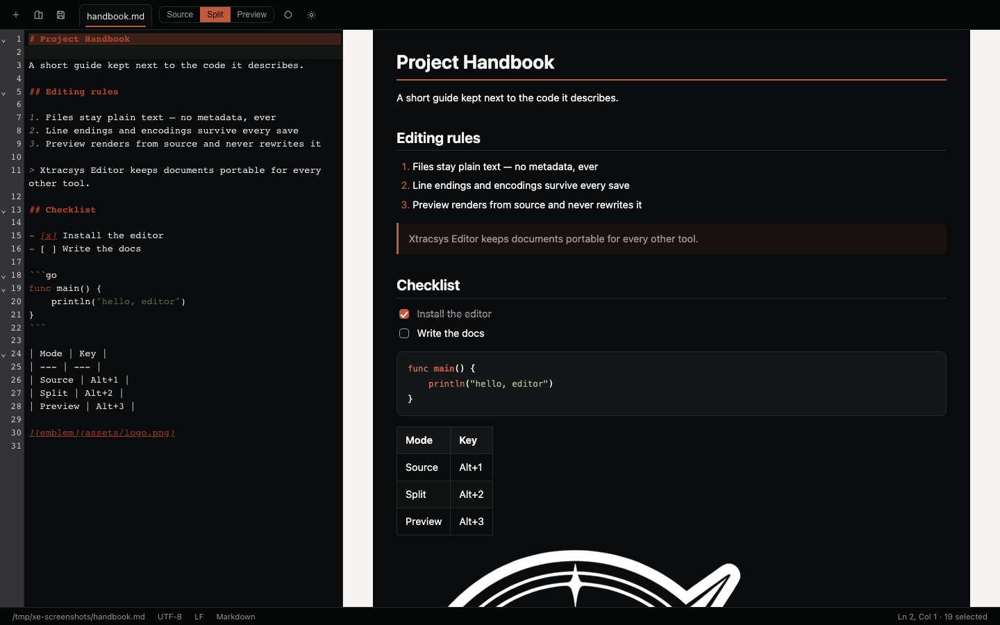

# Xtracsys Editor

A local-first desktop editor for plain text, code, configuration files, and
Markdown — built for one non-negotiable rule: **your files stay ordinary,
portable text files, byte-for-byte what you saved.**



| Dark preview | Dark split editing |
| --- | --- |
|  |  |

> **Working title.** “Xtracsys Editor” is a provisional product name, not a
> finalized one.

## Why this editor

Every editing feature is built around file integrity:

- **Open anything textual** — any extension, no extension, dotfiles. Binary
  files and unsupported encodings are refused with an explanation, never
  mangled.
- **Byte-faithful saves.** Encoding (UTF-8 ± BOM, UTF-16 LE/BE with BOM), line
  endings (LF, CRLF, CR — including *mixed* endings, per line), trailing
  whitespace, and the presence/absence of a final newline all survive an
  open → edit → save cycle exactly. Opening and closing a file without edits
  leaves it untouched; saving an unchanged file writes nothing.
- **No injection, ever.** No metadata, identifiers, branding, front matter,
  invisible characters, cursor positions, or proprietary wrappers are added to
  documents. Ever. This is enforced by design and by test.
- **No automatic reformatting.** No whitespace trimming, newline insertion, or
  encoding conversion unless you explicitly change the content.
- **Safe saves.** Writes go to a hidden temp file next to the document, are
  fsynced, inherit the original permissions, and are atomically renamed into
  place. Symbolic links are resolved, never replaced. A crash mid-save leaves
  at worst the old file, never a truncated one.
- **External changes respected.** Files modified on disk after opening are
  detected; nothing is silently overwritten — you decide.
- **Local-first and private.** No accounts, telemetry, or background network
  calls. All functionality works offline. The Markdown preview blocks remote
  resources by default and runs in a sandboxed frame with scripts disabled.
  Opening a file never executes it.

## Editing features

- Tabs with dirty-state indicators and unsaved-work prompts
- Line numbers, syntax highlighting for 130+ languages (filename *and*
  shebang detection), bracket matching, code folding
- Undo/redo, find & replace (panel: `⌘/Ctrl+F`), multiple selections
- Indentation controls (tab width, spaces/tabs) and word-wrap toggle
- **Open With support** — open documents from the Finder ("Open With",
  dragging onto the Dock icon), from the command line, or by dragging files
  onto the editor window; multiple files arrive in order as separate tabs
- Status bar: full path, encoding, line-ending style, language, cursor position
- Standard shortcuts (`⌘/Ctrl+N/O/S/W`, `⌘⇧S`, `⌘/Ctrl+,` …) — see
  Help → Keyboard Shortcuts

## Markdown: source, split, preview

For Markdown documents (`.md`, `.markdown`, …) a mode switch appears:

- **Source** — edit the plain text
- **Split** — source and live preview side by side
- **Preview** — rendered document only

The preview supports headings, lists, links, images, blockquotes, fenced code
blocks with syntax highlighting, tables, and task lists. Rendering is derived
from the source; switching modes or themes **never writes to the file**.
Local images resolve relative to the document — and only from the document's
own folder tree, content-sniffed, size-capped, SVG excluded. External links
open in the system browser only when clicked.

## Auto-save

**Off by default.** Enable it in Settings; the idle delay is configurable.
When on, it saves *named* files after the idle delay — never untitled
documents, and never files that changed on disk (no silent overwrites). Your
choice persists across launches. When off, editing never writes to the
original file until you explicitly save.

## Crash recovery

Unsaved changes are periodically snapshotted to the app's private data
folder (never next to your documents, never inside them). If the editor
crashes or is force-quit, the next start offers to restore them as unsaved
tabs — **nothing is written to your files until you save**. Snapshots are
private (0600), cleared on save/close/discard, and disclosed in Settings.
This feature is always on; there is no crash-recovery data anywhere else.

## Settings & state

Preferences live in the OS application-data folder
(`~/Library/Application Support/xtracsys-editor` on macOS, `%APPDATA%` on
Windows, `~/.config/xtracsys-editor` on Linux). Nothing — no lock files, no
metadata folders, no backups — is ever written next to your documents.

## Install

Prebuilt packages are not published yet. Until the first release, build from
source (below) — it takes one command on each platform.

## Build from source

Prerequisites: [Go 1.24+](https://go.dev/dl/), Node.js 18+, and:

- **macOS** — Xcode Command Line Tools (`xcode-select --install`)
- **Windows** — WebView2 runtime (preinstalled on Windows 10/11) and
  [NSIS](https://nsis.sourceforge.io/) (optional, for installers)
- **Linux** — `libgtk-3-dev libwebkit2gtk-4.1-dev` (Ubuntu/Debian package names)

```bash
git clone <repository-url>
cd xtracsys-editor
go install github.com/wailsapp/wails/v2/cmd/wails@v2.17.0

wails build                 # optimized build of your platform (build/bin/)
wails build -debug          # debug build
```

Artifacts land in `build/bin/` — an `.app` on macOS, an `.exe` on Windows, a
binary (+ optional packages with `-f nsis` / `-f appimage`) on Linux.

### Tests

```bash
go test ./...               # file-integrity core (every platform, headless)
cd frontend && npm ci && npm test   # frontend unit tests (vitest)
npm run build               # build the frontend bundle once
cd .. && npx playwright install chromium && npx playwright test   # acceptance E2E
```

The E2E suite starts `cmd/e2e-serve`, a loopback-only test harness that serves
the real frontend against the real Go backend — the same suites run in CI on
all three operating systems.

## Platform status

Honest status as of this build — see [docs/PLATFORM-STATUS.md](docs/PLATFORM-STATUS.md)
for the live matrix:

| Platform | Built | Auto-tested | Notes |
| --- | --- | --- | --- |
| macOS 13+ (arm64, x86_64, universal) | ✅ | ✅ (Go, vitest, E2E) | Ad-hoc signed; not notarized |
| Windows 10 1809+ (x64) | via CI workflow | CI: Go + vitest + E2E | Runtime testing pending hardware |
| Linux (x64/arm64, webkit2gtk-4.1) | via CI workflow | CI: Go + vitest + E2E | Runtime testing pending hardware |

## Security

A full security audit (three independent reviews plus govulncheck/npm-audit
dependency scans) with all findings and fixes is in
[docs/SECURITY-AUDIT.md](docs/SECURITY-AUDIT.md). Report vulnerabilities via
[SECURITY.md](SECURITY.md).

## License & trademarks

Source code is licensed under the [Apache License 2.0](LICENSE). That license
covers the *application source*, not your documents. It also does **not**
grant rights to Xtracsys trademarks or logos — see
[TRADEMARKS.md](TRADEMARKS.md). Third-party notices:
[THIRD-PARTY-NOTICES.md](THIRD-PARTY-NOTICES.md).

## Contributing & security

See [CONTRIBUTING.md](CONTRIBUTING.md) and [SECURITY.md](SECURITY.md).

## Repository layout

```
internal/fileio      byte-faithful load/save core + tests (the heart)
internal/app         application service bound to the UI
internal/settings    OS-app-data settings
internal/localimg    sandboxed preview images
frontend/            TypeScript/CodeMirror 6 editor UI
cmd/e2e-serve        headless E2E bridge (test harness, not shipped)
build/               platform packaging assets & icons
docs/                architecture, brand, platform status, requirements
tests/e2e            Playwright acceptance suite
```
